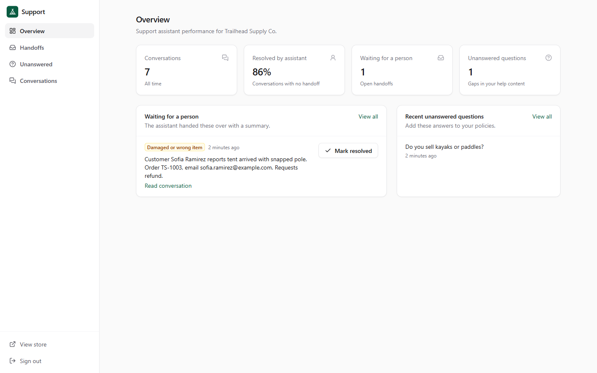
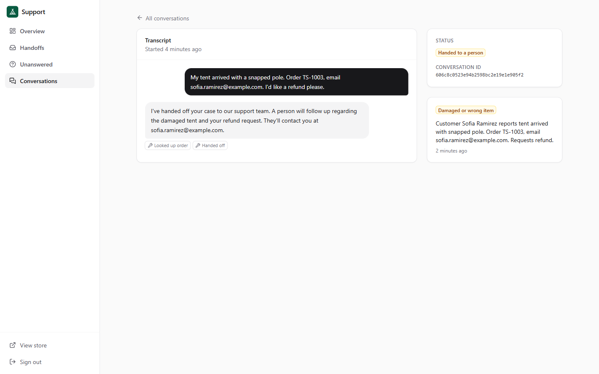
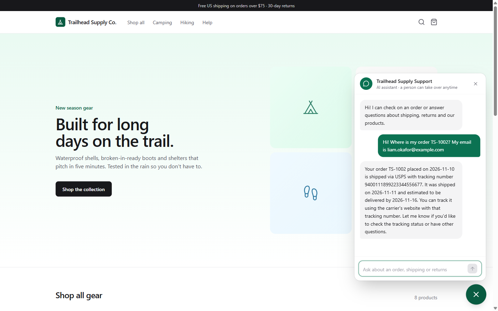
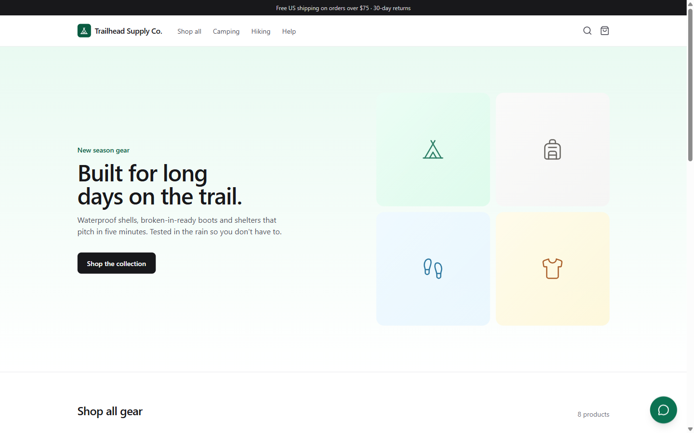
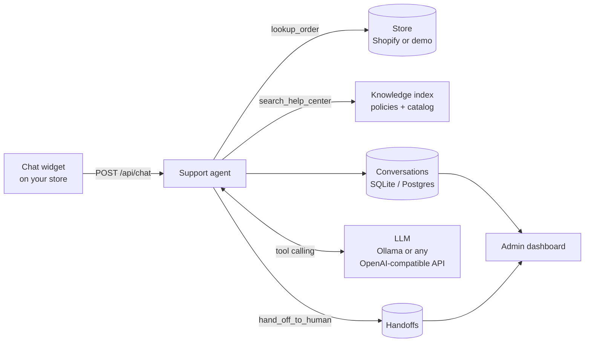

# ai-support-agent

[](https://github.com/Sanoy24/ai-support-agent/actions/workflows/ci.yml)
[](LICENSE)

**An AI customer support agent for online stores.** It answers "where's my order?", shipping, returns and product questions from your real store data, and hands anything involving money or judgment to your team, with a summary so nobody has to reread the chat.

Runs entirely on your own machine with free local models, or with any hosted model you prefer.

[](https://www.youtube.com/watch?v=wgjD3xhUipU)

<p align="center"><b><a href="https://www.youtube.com/watch?v=wgjD3xhUipU">▶ Watch the 2-minute demo</a></b>: order lookup, a refund handed to a person, and the admin dashboard.</p>

## What it does

**For your customers**

- **Order status in seconds.** The assistant looks up the order (status, carrier, tracking number, delivery estimate) after checking that the email matches the order.
- **Answers from your own policies.** Shipping, returns, warranty, payments and sizing questions are answered from your policy documents and product catalog, with the sources shown under each answer.
- **A person when it matters.** Refunds, cancellations, damaged items, complaints, or "can I talk to someone?" are passed to your team instead of being improvised.
- **One script tag.** Add the chat widget to any website, Shopify theme included.

**For your team**

- **Handoff inbox.** Each handoff arrives with a category (refund, damaged item, complaint and so on) and a short summary of what the customer needs.
- **Unanswered questions.** Every question your policies couldn't answer is listed, so you know exactly what to add to your help content.
- **Full transcripts.** See every conversation, which tools the assistant used and which policy sections it relied on.

<table>
  <tr>
    <td></td>
    <td></td>
  </tr>
  <tr>
    <td align="center"><sub>Handoffs and gaps in your help content, at a glance</sub></td>
    <td align="center"><sub>A refund request: the order is verified, then handed to a person</sub></td>
  </tr>
</table>

<details>
<summary>More screenshots</summary>





</details>

## Built to be safe with real customers

| Risk | How it's handled |
|---|---|
| The bot promises a refund it shouldn't | The assistant has **no tools that change orders or money**. Refunds, cancellations and exceptions always go to a person. This is enforced in code, not just in the prompt. |
| Someone guesses emails to see other people's orders | Lookups require the order number **and** the matching email. Wrong email and unknown order give the same response, and failed lookups are capped per conversation. |
| The bot makes up a policy | Policy answers come from your documents. If nothing relevant is found, it says so, offers a person, and logs the gap. |
| Prompt injection ("ignore your instructions...") | Tool results are treated as data, and the assistant's permissions don't change whatever it's told. |
| The widget breaks your site's design | The widget renders in an isolated Shadow DOM, so your styles and its styles can't affect each other. |
| The admin dashboard is attacked | Password sign-in issues a signed, HttpOnly, SameSite=Strict session cookie. Login attempts and chat messages are rate limited. |

## How it works



1. The customer writes in the widget.
2. The agent decides what it needs: an order lookup, a search of your policies and catalog, or a handoff.
3. Order data comes from your store's API (read-only). Policy answers come from the passages the search returns.
4. The reply goes back with its sources. Handoffs and unanswered questions are saved for your team.

## Quick start

### Option 1: run locally (free, no API keys)

Requirements: [Python 3.12+](https://www.python.org/), [uv](https://docs.astral.sh/uv/), [Node.js 22+](https://nodejs.org/) and [Ollama](https://ollama.com/).

```bash
ollama pull granite4.2:8b
ollama pull nomic-embed-text

git clone https://github.com/Sanoy24/ai-support-agent.git
cd ai-support-agent
cp .env.example .env              # set ADMIN_PASSWORD to enable the dashboard

npm --prefix frontend ci
npm --prefix frontend run build
uv run support-agent
```

Open <http://localhost:8000> for the demo store and <http://localhost:8000/admin> for the dashboard.

### Free hosted models (faster than local)

On a laptop without a GPU, local models take 20 to 60 seconds per reply. [OpenRouter](https://openrouter.ai/) offers free models that answer in a few seconds. Create a key, then set:

```bash
LLM_BASE_URL=https://openrouter.ai/api/v1
LLM_API_KEY=sk-or-...
LLM_MODEL=nvidia/nemotron-3.5-lightning:free
LLM_FALLBACK_MODELS=google/gemma-4-26b-a4b-it:free,inclusionai/ling-3.2-flash:free
LLM_REASONING_EFFORT=
```

Free models are rate limited, so the fallbacks and automatic retries matter. For real traffic, switch to a paid model by changing `LLM_MODEL`.

### Option 2: Docker

With Ollama running on your machine:

```bash
cp .env.example .env
docker compose up --build
```

### Try it

The demo store has fictional orders you can ask about:

| Order | Email | Status |
|---|---|---|
| `TS-1002` | `liam.okafor@example.com` | Shipped |
| `TS-1003` | `sofia.ramirez@example.com` | Delivered (try a damaged-item refund) |
| `TS-1001` | `maya.chen@example.com` | Delivered |

Then try "What's your return policy?", "Do the boots run true to size?", "My tent arrived broken, I want a refund" or "Do you sell kayaks?".

## Configuration

All settings are environment variables (or entries in `.env`). See [`.env.example`](.env.example) for the full list.

| Setting | Default | Description |
|---|---|---|
| `STORE_NAME` | `Trailhead Supply Co.` | Name the assistant uses for your store |
| `STORE_BACKEND` | `mock` | `mock` (demo data) or `shopify` |
| `POLICIES_DIR` | demo policies | Folder of Markdown files with your shipping, returns and FAQ content |
| `LLM_BASE_URL` | `http://localhost:11434/v1` | Any OpenAI-compatible endpoint: Ollama, OpenAI, OpenRouter, Groq and others |
| `LLM_MODEL` | `granite4.2:8b` | Model name at that endpoint. It must support tool calling |
| `LLM_API_KEY` | none | Needed for hosted providers only |
| `LLM_FALLBACK_MODELS` | none | Comma-separated models to try when the main one is rate limited (OpenRouter) |
| `EMBEDDINGS_BACKEND` | `ollama` | `ollama`, `fastembed` or `hashing` (offline, keyword-based) |
| `ADMIN_PASSWORD` | none | Enables the admin dashboard |
| `SESSION_SECRET` | random | Signs admin sessions; set it so sign-ins survive restarts |
| `ALLOWED_ORIGINS` | none | Websites allowed to call the API when the widget is embedded on another domain |
| `DATABASE_URL` | SQLite file | Any SQLAlchemy URL, e.g. `postgresql+psycopg://...` |

### Connecting Shopify

1. In your Shopify admin, create a custom app with the **`read_orders`** and **`read_products`** Admin API scopes. No write access is needed.
2. Set:

   ```bash
   STORE_BACKEND=shopify
   SHOPIFY_SHOP_DOMAIN=your-store.myshopify.com
   SHOPIFY_ACCESS_TOKEN=shpat_...
   ```

### Adding the widget to your site

```html
<script
  src="https://support.your-store.com/widget.js"
  defer
  data-title="Your Store Support"
  data-color="#1f6b52"
></script>
```

Optional attributes: `data-greeting`, and `data-suggestions` (separated by `|`). If the widget is served from a different domain than your store, add your store's URL to `ALLOWED_ORIGINS`.

## Development

```bash
uv sync                              # Python dependencies
uv run pre-commit install
npm --prefix frontend ci             # frontend dependencies

uv run support-agent --reload        # API on :8000
npm --prefix frontend run dev        # frontend with hot reload on :5173
```

Checks (all run in CI):

```bash
uv run ruff check . && uv run ruff format --check . && uv run mypy && uv run pytest
npm --prefix frontend run lint && npm --prefix frontend run build
```

### Project layout

```
src/support_agent/
  agent/       the agent loop, tools and system prompt
  knowledge/   chunking, embeddings and the vector index
  llm/         OpenAI-compatible client and a scripted test model
  store/       store models, demo store and Shopify adapter
  api/         FastAPI app, admin API, auth and rate limiting
  service.py   connects the agent to the database
  demo/        demo store data and policy documents
frontend/
  src/widget/  the embeddable chat widget (Preact, Shadow DOM)
  src/pages/   demo storefront and admin dashboard (React)
tests/         unit and API tests (no LLM or network needed)
```

## Roadmap

- WhatsApp and email channels
- Streaming replies
- Notifications to Slack or email for new handoffs
- More store platforms (WooCommerce, BigCommerce)

## Contributing

Contributions are welcome. See [CONTRIBUTING.md](CONTRIBUTING.md). Please report security issues privately as described in [SECURITY.md](SECURITY.md).

## License

[MIT](LICENSE)
